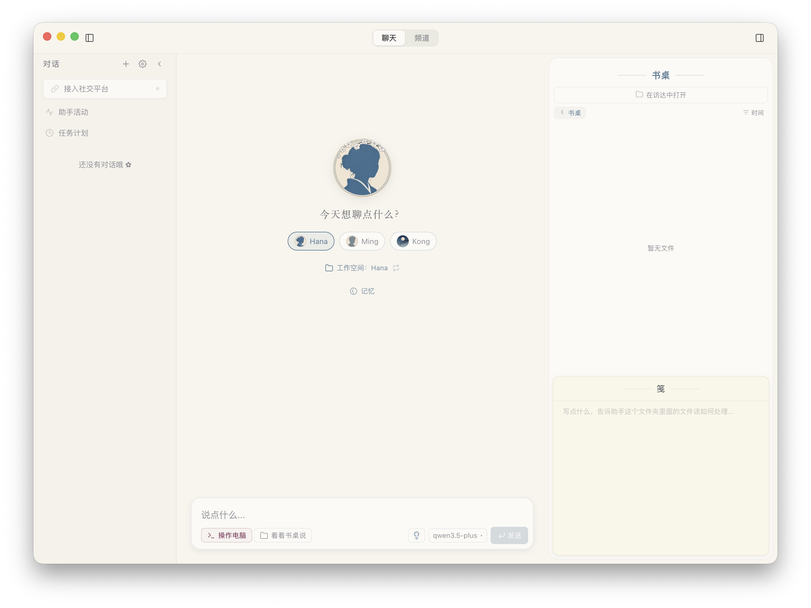

<p align="center">
  
</p>

<h1 align="center">hanaagent</h1>

<p align="center">有记忆、可扩展的本地优先 AI 助理</p>
<p align="center"><a href="docs/README_EN.md">English</a> · <a href="docs/README.md">文档导航</a></p>

[](LICENSE)

hanaagent 由 [zxdwhda](https://github.com/zxdwhda) 独立维护，基于 [liliMozi/openhanako](https://github.com/liliMozi/openhanako) 的公开 **0.450.0** 源码，当前独立版本为 **0.450.1**。感谢原作者与贡献者；项目保留其版权、Apache-2.0 许可证与第三方许可。

它提供桌面图形界面，用于与 AI 对话、处理文件、使用工具和管理多个 Agent。记忆、人格、Skills、插件与消息渠道等能力继承自上游公开实现，详细入口见[功能概览](docs/usage/features.md)。

## 当前维护状态

本方改动集中在独立应用与数据目录、启动修复、消息渠道防双接管，以及本地安装、更新和回退管理。完整来源与差异见[独立维护说明](docs/maintenance/INDEPENDENT_MAINTENANCE.md)。

| 范围 | 当前状态 |
| --- | --- |
| macOS Apple Silicon | 已有本地构建、真实模型聊天、文件操作和部分消息渠道验证记录 |
| macOS Intel、Windows、Linux、移动端 | 保留上游实现，本方尚未验收 |
| 模型与插件 | 部分流程已验证，尚未覆盖全部集成 |
| 分发 | 公开源码；尚无本项目公开安装包、Developer ID 签名、公证或线上更新服务 |

上述状态来自 2026-11-08 的既有[维护记录](docs/maintenance/INDEPENDENT_MAINTENANCE.md)，不表示每项功能均已验证。本项目为独立维护版本；未恢复上游已移除功能，也不包含作者后续闭源版本的新增能力。

## 从源码开始

使用 Node.js 24（参考版本 24.15.0）和 npm。在仓库根目录执行：

```sh
npm ci
HANA_HOME="$HOME/.hanaagent-dev" npm start
```

上例适用于 macOS/Linux Shell；Windows PowerShell 设置方式、编译工具与首次模型配置见[运行指南](docs/usage/quick-start.md)。源码启动命令默认使用 `~/.hanaagent-dev`，可用 `HANA_HOME` 覆盖；正式应用默认使用 `~/.hanaagent`。

构建、安装、更新和回退见[本地版本管理](docs/maintenance/LOCAL_RELEASES.md)。

## 文档入口

| 需求 | 文档 |
| --- | --- |
| 运行、首次配置与功能 | [运行指南](docs/usage/quick-start.md) · [功能概览](docs/usage/features.md) |
| 开发与代码结构 | [贡献指南](.github/CONTRIBUTING.md) · [架构与技术栈](docs/development/architecture.md) |
| 编写插件 | [插件开发指南](docs/development/PLUGINS.md) · [Plugin SDK](docs/development/PLUGIN_SDK.md) |
| 来源与版本维护 | [来源基线](docs/maintenance/FORK_BASELINE.md) · [独立维护说明](docs/maintenance/INDEPENDENT_MAINTENANCE.md) · [本地版本管理](docs/maintenance/LOCAL_RELEASES.md) |
| 目录和材料归属 | [目录说明](docs/maintenance/directories.md) |

完整导航见 [docs/README.md](docs/README.md)。

## 界面

<p align="center">
  
</p>

截图沿用上游资料，仅展示界面形态，不作为独立版本的功能验收证据。

## 参与与来源

欢迎通过 [Issues](https://github.com/zxdwhda/hanaagent/issues) 报告问题、提出需求，或按[贡献指南](.github/CONTRIBUTING.md)提交 PR。漏洞请按[安全政策](.github/SECURITY.md)私密报告；社区协作遵循[行为准则](.github/CODE_OF_CONDUCT.md)。

上游来源为 [liliMozi/openhanako](https://github.com/liliMozi/openhanako)。保留原作者与贡献者归属，见 [NOTICE](NOTICE) 和 [Apache License 2.0](LICENSE)。沿用上游致谢：[tw93/kami](https://github.com/tw93/kami) 为 beautify 插件 HTML 美学指南的渐进披露结构提供了启发。
