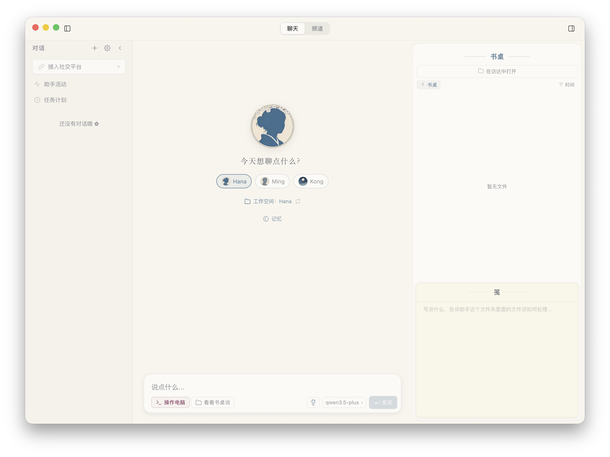

<p align="center">
  
</p>

<h1 align="center">hanaagent</h1>

<p align="center">A local-first AI assistant with memory and extensibility</p>
<p align="center"><a href="../README.md">中文</a> · <a href="README.md">Documentation</a></p>

[](../LICENSE)

Independently maintained by [zxdwhda](https://github.com/zxdwhda), based on [liliMozi/openhanako](https://github.com/liliMozi/openhanako) public **0.450.0** source. The current independent version is **0.450.1**. Credit, copyright, Apache-2.0 and third-party notices remain with the original author and contributors.

The desktop interface supports AI conversations, file tasks, tools and multiple agents. Memory, personalities, Skills, plugins and messaging channels are inherited from the public upstream implementation; see [Features](usage/features_EN.md).

## Maintenance status

Independent changes focus on application/data isolation, startup fixes, channel ownership checks, and local installation, updates and rollback. See the [maintenance scope (Chinese)](maintenance/INDEPENDENT_MAINTENANCE.md).

| Scope | Status |
| --- | --- |
| macOS Apple Silicon | Existing local validation covers builds, real-model chat, file operations and some messaging channels |
| macOS Intel, Windows, Linux, mobile | Upstream implementation retained; not yet validated by this maintainer |
| Models and plugins | Some flows exercised; not all integrations validated |
| Distribution | Source only; no project public installer, Developer ID signing, notarization or online update service yet |

This status comes from the existing [2026-11-08 maintenance record (Chinese)](maintenance/INDEPENDENT_MAINTENANCE.md), not validation of every feature. This independent version does not restore removed upstream features or implement additions from the author's later closed-source releases.

## Run from source

Use Node.js 24 (reference version 24.15.0) and npm. From the repository root:

```sh
npm ci
HANA_HOME="$HOME/.hanaagent-dev" npm start
```

The example uses macOS/Linux shell syntax. See [Running and first setup](usage/quick-start_EN.md) for Windows PowerShell, build prerequisites and model configuration. Source launch commands default to `~/.hanaagent-dev`, overridable through `HANA_HOME`; the production application defaults to `~/.hanaagent`.

For packaging, installation, updates and rollback, see [Local release management (Chinese)](maintenance/LOCAL_RELEASES.md).

## Documentation

| Goal | Documentation |
| --- | --- |
| Run, configure and explore | [Quick start](usage/quick-start_EN.md) · [Features](usage/features_EN.md) |
| Develop and understand the code | [Contributing](../.github/CONTRIBUTING.md) · [Architecture](development/architecture_EN.md) |
| Build plugins | [Plugin guide](development/PLUGINS_EN.md) · [Plugin SDK](development/PLUGIN_SDK.md) |
| Check provenance and maintain releases | [Source baseline](maintenance/FORK_BASELINE.md) · [Maintenance scope](maintenance/INDEPENDENT_MAINTENANCE.md) · [Local releases](maintenance/LOCAL_RELEASES.md) (Chinese) |
| Locate files and records | [Directory guide (Chinese)](maintenance/directories.md) |

See the full [documentation index](README.md).

## Interface

<p align="center">
  
</p>

The screenshot is retained from upstream for illustration, not evidence of feature acceptance in this distribution.

## Contributing and attribution

[Issues](https://github.com/zxdwhda/hanaagent/issues) and pull requests are welcome; see [Contributing](../.github/CONTRIBUTING.md), [Security](../.github/SECURITY.md) and the [Code of Conduct](../.github/CODE_OF_CONDUCT.md).

Upstream: [liliMozi/openhanako](https://github.com/liliMozi/openhanako). Original author and contributor attribution is retained in [NOTICE](../NOTICE) and [Apache License 2.0](../LICENSE). Retained upstream acknowledgment: [tw93/kami](https://github.com/tw93/kami) inspired the progressive-disclosure structure of the beautify plugin's HTML aesthetic guide.
